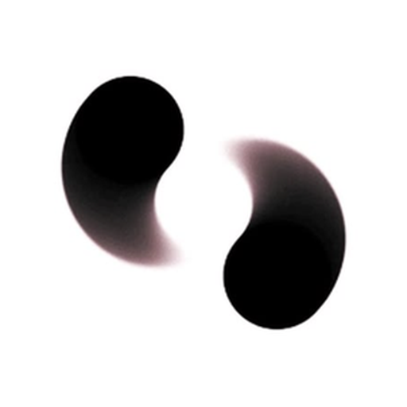
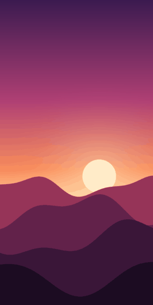
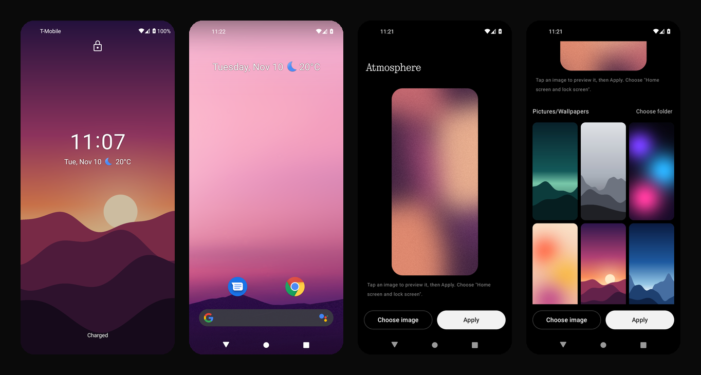

<div align="center">



# Nothing Atmosphere Wallpaper

**The Nothing OS Atmosphere live wallpaper, on any Android phone.**<br/>
Your photo on the lock screen. Unlock, and it melts into soft, grainy colour, exactly like a Nothing Phone.

[](https://github.com/Shashtwat/nothing-atmosphere-wallpaper/releases/latest/download/NothingAtmosphere.apk)

[](https://github.com/Shashtwat/nothing-atmosphere-wallpaper/releases/latest)
[](https://github.com/Shashtwat/nothing-atmosphere-wallpaper/releases)
[](#compatibility)
[](https://github.com/Shashtwat/nothing-atmosphere-wallpaper/actions/workflows/build.yml)
[](LICENSE)



</div>

---

Atmosphere is the wallpaper effect from **Nothing OS** on Nothing phones such as the **Nothing Phone (3)**:
the lock screen shows your photo, and when you unlock, its colours bloom out of the image and blur into a
calm, grainy gradient on the home screen. This app brings that effect to **Pixel, Samsung Galaxy,
OnePlus, Xiaomi, Motorola** and any other phone running Android 8.0 or newer.

It isn't an imitation filter. The engine was rebuilt from how Nothing's own wallpaper renderer works,
down to its timing curve, blur kernel, colour extraction and shape growth, then checked frame by frame.
[How it works →](docs/HOW_IT_WORKS.md)

<div align="center">

</div>

## Features

- **The real Atmosphere unlock.** About three seconds from sharp photo to soft colour, with the same
  easing, blur, grain and blooming shapes as Nothing OS.
- **Use any photo.** Pick a single image, or point the app at a folder (it starts with
  `Pictures/Wallpapers`) and tap through your collection.
- **Preview before you apply.** The app plays the unlock on a loop so you see the result first.
- **A different unlock every time.** The shapes take a new path each time you lock the phone.
- **Matches your theme.** The wallpaper reports its colours, so Material You can pick them up.
- **Light on battery.** It only draws while the animation is running, then holds still.
- **Private.** No internet permission, no ads, no analytics, no accounts. Your photos never leave the
  phone.
- **Tiny.** About 1 MB.

## Install

1. **[Download the APK](https://github.com/Shashtwat/nothing-atmosphere-wallpaper/releases/latest/download/NothingAtmosphere.apk)**
   (or pick a version from [Releases](https://github.com/Shashtwat/nothing-atmosphere-wallpaper/releases)).
2. Open it. If Android asks, allow your browser or file manager to install unknown apps.
3. Open **Nothing Atmosphere**, tap a wallpaper, then **Apply**.
4. Choose **Home screen and lock screen**. This matters: with the same wallpaper behind the lock screen,
   the effect starts the instant you unlock, like it does on a Nothing Phone.

Lock your phone and unlock it. That's it.

## Compatibility

| | |
|---|---|
| Android version | 8.0 (Oreo, API 26) and newer |
| Tested on | Android 8.0 and 11 (emulator, arm64), Android 17 (Pixel 10) |
| Graphics | OpenGL ES 3.0 (every Android 8+ phone in practice) |
| Screens | Any resolution and aspect ratio |
| Architectures | All (no native code) |
| Root | Not needed |

On a Nothing Phone, the system sends the wallpaper a private "unlocked" signal. Other phones don't, so
the app watches the lock state instead. On a Pixel the effect starts about 40 ms after the fingerprint
is accepted, which is around three frames. Details in [How it works](docs/HOW_IT_WORKS.md#4-lock-and-unlock).

## FAQ

**Is this the official Nothing wallpaper?**<br/>
No. It's an independent, open-source recreation. Nothing isn't involved.

**I already own a Nothing Phone. Do I need this?**<br/>
Not really. Atmosphere is built into Nothing OS.

**Why does Android show its own "Set wallpaper" screen?**<br/>
Android only lets that system screen apply a live wallpaper. Every live wallpaper goes through it.

**Will it drain my battery?**<br/>
No. It renders for about three seconds after an unlock, then stops drawing until the next one.

**Does it work with any launcher?**<br/>
Yes. It's a standard Android live wallpaper.

**The animation doesn't play when I unlock.**<br/>
Make sure you applied it to both the home screen and the lock screen. Some phones run their own
lock-screen wallpaper on top; if yours does, the effect still plays as the home screen appears.

**Can I use my own photos?**<br/>
Yes: **Choose image** for a single file, or **Choose folder** to browse a whole folder.

## Build from source

Requirements: JDK 17 and the Android SDK (platform 34).

```sh
git clone https://github.com/Shashtwat/nothing-atmosphere-wallpaper.git
cd nothing-atmosphere-wallpaper
./gradlew assembleRelease
# app/build/outputs/apk/release/NothingAtmosphere-<version>-release.apk
```

Without a signing configuration, release builds are signed with your local debug key. To use your own key,
create a properties file with `storeFile`, `storePassword`, `keyAlias` and `keyPassword` and point
`ATMOSPHERE_SIGNING` at it.

Pull requests are welcome. Please run `./gradlew lintRelease` first; CI does the same and keeps the app
compatible down to Android 8.0.

## Credits

- The engine started from [Nothing Wallpaper Changer](https://github.com/NineCSdev/nothing-wallpaper-changer)
  by NineCSdev (MIT), and was then reworked to match Nothing OS behaviour exactly.
- Early reference: NOSAtmosphereEffect by Saad Ullah Khan (MIT).
- NDot and NType typefaces © Nothing Technology Limited, used in the app's interface.

See [licenses/](licenses/) for full notices.

## Disclaimer

Nothing, Nothing Phone and Nothing OS are trademarks of Nothing Technology Limited. This project is not
affiliated with, endorsed by or sponsored by Nothing. Demo wallpapers in this repository are original
artwork made for the project.

## License

[MIT](LICENSE) © 2026 Shashwat

<sub>Keywords: Nothing OS wallpaper, Nothing Phone 3 wallpaper, Nothing Atmosphere, Atmosphere live
wallpaper, Nothing OS 5, unlock blur wallpaper, blur live wallpaper APK, Nothing wallpaper for Pixel,
Nothing wallpaper for Samsung, Nothing Phone wallpaper app, grainy gradient wallpaper, Android live
wallpaper, free, open source.</sub>
